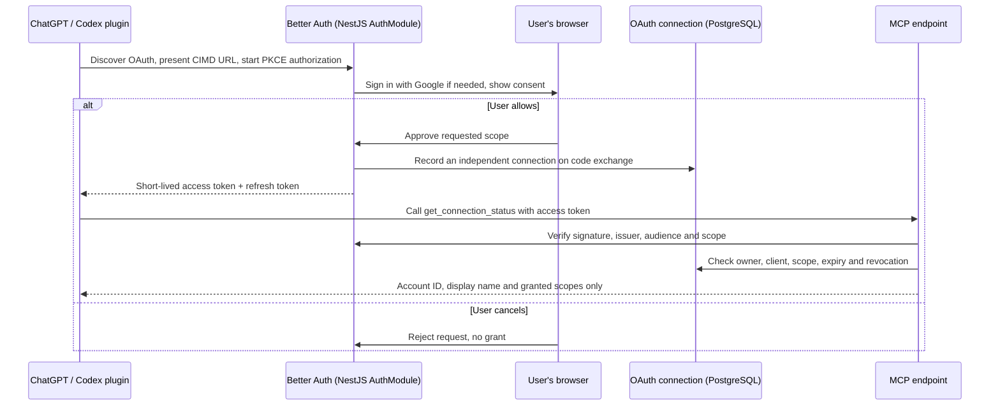

# MCP OAuth and Authorization

**Status:** Local, opt-in trial only. `MCP_ENABLED` defaults to `false`; production activation is blocked.

**Design summary.**

A single Better Auth instance handles Google sign-in and MCP OAuth, while browser sessions remain separate from MCP connections. Explicit consent through authorization code with PKCE creates a scoped, client-specific connection; access tokens last 15 minutes, and refresh cannot extend the connection's fixed 30-day lifetime. Each MCP call verifies the token and checks the persisted connection for scope, expiry and revocation, because a valid JWT alone cannot provide immediate revocation. Client identity comes from allowlisted metadata rather than open registration; the current tool exposes only minimal connection status, not resume data.

**Ownership.** `auth/` configures Better Auth and verifies tokens; `oauth/` (a directory, not a separate NestJS module) owns persisted connection rules; `mcp/` owns Streamable HTTP and the tool. The plugin distributes connection configuration, not the server. Browser sign-out does not revoke an MCP connection; `connection:read` is the only business scope (`offline_access` permits refresh).

**Current limit.** The local trial has a known refresh-replay race: a replay can invalidate another connection for the same user/client. The regression remains failing; connection-management UI, full desktop interoperability and production security acceptance are not complete. Do not expose this trial publicly.
